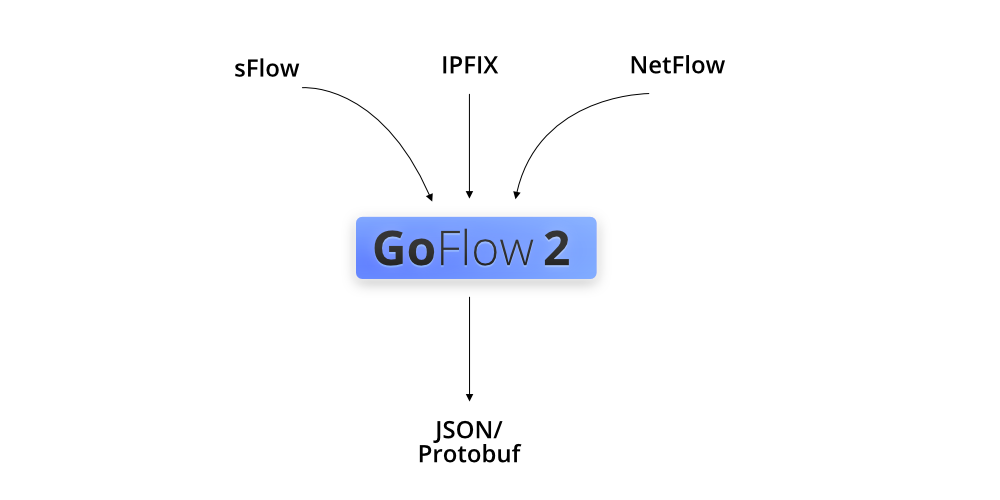

# GoFlow2

[](https://github.com/netsampler/goflow2/actions?query=workflow%3ABuild)
[](https://pkg.go.dev/github.com/netsampler/goflow2/v3)

This application is a NetFlow/IPFIX/sFlow collector in Go.

It gathers network information (IP, interfaces, routers) from different flow protocols,
serializes it in a common format.

You will want to use GoFlow if:
* You receive a decent amount of network samples and need horizontal scalability
* Have protocol diversity and need a consistent format
* Require raw samples and build aggregation and custom enrichment

This software is the entry point of a pipeline. The storage, transport, enrichment, graphing, alerting are
not provided.



## ReFlow

ReFlow is an experimental binary for collecting, converting, and aggregating network
traffic. Build a portable binary and collect IPFIX as JSON:

```bash
CGO_ENABLED=0 go build -o reflow ./cmd/reflow
./reflow -input udp::4739:flow -output json:stdout
```

The `flow` input detects IPFIX, NetFlow v5/v9, and sFlow v5. Repeat `-input` to
listen on several sockets. With no flags, ReFlow listens on UDP ports 2055 and 6343
and writes JSON to stdout.

In another terminal, send an example flow to the collector above:

```bash
printf '%s\n' '{"src_addr":"192.0.2.1","dst_addr":"198.51.100.2","proto":17,"src_port":12345,"dst_port":53,"bytes":128,"packets":1}' |
  ./reflow -input stream:-:json -output ipfix:udp:127.0.0.1:4739
```

JSON streams contain one object per line; `-` reads stdin. JSON input accepts both
ReFlow JSON output and plain field objects. Use `-output json:stdout` to
inspect events or `-output protobuf:file:flows.pb` to save protobuf.

Aggregate packets from a capture into IPFIX flows, grouped by addresses, ports,
protocol, and source ID:

```bash
./reflow -input stream:traffic.pcap:pcap -agg \
  -output ipfix:udp:127.0.0.1:4739
```

`-agg` sums packet and byte counts, flushes idle flows after 10 seconds, and emits
snapshots every 60 seconds. EOF or Ctrl-C flushes remaining flows. PCAPNG input is
also supported. Live capture uses `pcap_live:<interface>:bytes` with a libpcap/cgo
build, or `ebpf:<interface>:bytes` on Linux.

Use `-list-options` for supported inputs, outputs, and aggregation settings. To
customize a pipeline, add `-genconf > reflow.yaml` to a command, edit the generated
YAML, then run `./reflow -config reflow.yaml`. An
[interface options example](cmd/reflow/reflow-json-interface-options-to-ipfix.yaml)
shows custom aggregation fields and IPFIX options export.

### Linux packages

The `ReFlow` workflow builds `.deb` and `.rpm` packages for amd64, arm64, and
ARMv7 alongside the archives, and attaches them to tagged releases. Packages
install `/usr/bin/reflow`, a `reflow.service` systemd unit, and
`/etc/default/reflow`. Linux archives, packages, and Docker images use the
same static musl binary with eBPF and live libpcap capture enabled.

Set `REFLOW_ARGS` in `/etc/default/reflow` to configure the service, then run
`systemctl daemon-reload` and `systemctl enable --now reflow`. With no arguments,
ReFlow listens on UDP ports 2055 and 6343 and writes JSON to the journal.

To build both package formats locally on Linux, install FPM, RPM build tools,
and libpcap development files, then run `CGO_ENABLED=1 make package-reflow`.
Individual targets are `package-reflow-deb` and `package-reflow-rpm`.
Cross-compilation also needs a C compiler and libpcap built for the target.
The portable release builds use a static musl/libpcap toolchain; see
`.github/workflows/reflow.yml` for the compiler and linker settings. The options
file is preserved during upgrades.

### macOS archives

The `ReFlow` workflow builds archives for Intel (`darwin-amd64`) and Apple
Silicon (`darwin-arm64`). Both enable live capture through the system libpcap
and explicitly disable Linux-only eBPF support with `reflow_noebpf`.

To build an archive locally on macOS, run
`CGO_ENABLED=1 GOOS=darwin REFLOW_BUILD_TAGS=reflow_noebpf make package-reflow-tar`.

### Native ARMv7 router binary

The `ReFlow` workflow also builds a static Linux ARMv7 / EABI5 router binary
with eBPF and live libpcap capture enabled. It uses the same musl/libpcap
build as the Linux release matrix, checks the executable and pcap source tests
under Cortex-A9 QEMU, and publishes the archive and SHA-256 sidecar
as a durable prerelease for each commit pushed to `main`. These snapshots do
not replace the latest stable GoFlow2 release.

To install the binary matching a ReFlow container, read its
`org.opencontainers.image.revision` label and download these assets from
`https://github.com/netsampler/goflow2/releases/tag/reflow-<revision>`:

* `reflow-<revision>-linux-armv7.tar.gz`
* `reflow-<revision>-linux-armv7.tar.gz.sha256`

Verify the checksum before extracting `reflow` from the archive. The workflow
can also be dispatched to build only this native snapshot, with `source_ref`
set to a full commit SHA already merged into `main`, for example to publish
the native binary for an older container revision. Live capture needs packet
socket support and appropriate privileges. eBPF capture also needs kernel eBPF
and perf event support. The static binary has no libc runtime dependency.

## Origins

This work is a fork of a previous [open-source GoFlow code](https://github.com/cloudflare/goflow) built and used at Cloudflare.
It lives in its own GitHub organization to be maintained more easily.

Among the differences with the original code:
The serializer and transport options have been revamped to make this program more user-friendly
and target new use-cases like logging providers.
Minimal changes in the decoding libraries.

## Modularity

In order to enable load-balancing and optimizations, the GoFlow2 library has a `decoder` which converts
the payload of a flow packet into a structure.

The `producer` converts the samples into another format.
Out of the box, this repository provides a protobuf producer (`pb/flow.pb`)
and a raw producer.
In the case of the protobuf producer, the records in a single flow packet
are extracted and made in their own protobuf. Custom mapping allows
to add new fields without rebuilding the proto.

The `format` directory offers various utilities to format a message. It calls specific
functions to marshal as JSON or text for instance.

The `transport` provides different way of processing the message. Either sending it via Kafka or 
send it to a file (or stdout).

GoFlow2 is a wrapper of all the functions and chains them.

You can build your own collector using this base and replace parts:
* Use different transport (e.g: RabbitMQ instead of Kafka)
* Convert to another format (e.g: Cap'n Proto, Avro, instead of protobuf)
* Decode different samples (e.g: not only IP networks, add MPLS)
* Different metrics system (e.g: [OpenTelemetry](https://opentelemetry.io/))

The application wiring is organized under `pkg/goflow2` (config, logging, builder, collector,
httpserver, app) to simplify reuse across binaries (e.g., `cmd/goflow2`, `cmd/enricher`).

### Protocol difference

The sampling protocols have distinct features:

**sFlow** is a stateless protocol which sends the full header of a packet with router information
(interfaces, destination AS) while **NetFlow/IPFIX** rely on templates that contain fields (e.g: source IPv6).

The sampling rate in NetFlow/IPFIX is provided by **Option Data Sets**. This is why it can take a few minutes
for the packets to be decoded until all the templates are received (**Option Template** and **Data Template**).
Sampling rates are cached in the FlowStore with optional TTL and JSON persistence controls (see `sampling.*` flags).

Both of these protocols bundle multiple samples (**Data Set** in NetFlow/IPFIX and **Flow Sample** in sFlow)
in one packet.

The advantages of using an abstract network flow format, such as protobuf, is it enables summing over the
protocols (e.g: per ASN or per port, rather than per (ASN, router) and (port, router)).

To read more about the protocols and how they are mapped inside, check out [page](/docs/protocols.md)

### Features of GoFlow2

Collection:
* NetFlow v5
* IPFIX/NetFlow v9 (sampling rate provided by the Option Data Set)
* sFlow v5

(adding NetFlow v1,7,8 is being evaluated)

Production:
* Convert to protobuf or json
* Prints to the console/file
* Sends to Kafka and partition

Monitoring via Prometheus metrics

## Get started

To read about agents that samples network traffic, check this [page](/docs/agents.md).

To set up the collector, download the latest release corresponding to your OS
and run the following command (the binaries have a suffix with the version):

```bash
$ ./goflow2
```

By default, this command will launch an sFlow collector on port `:6343` and
a NetFlowV9/IPFIX collector on port `:2055`.

By default, the samples received will be printed in JSON format on the stdout.

```json
{
    "type": "SFLOW_5",
    "time_received_ns": 1681583295157626000,
    "sequence_num": 2999,
    "sampling_rate": 100,
    "sampler_address": "192.168.0.1",
    "time_flow_start_ns": 1681583295157626000,
    "time_flow_end_ns": 1681583295157626000,
    "bytes": 1500,
    "packets": 1,
    "src_addr": "fd01::1",
    "dst_addr": "fd01::2",
    "etype": "IPv6",
    "proto": "TCP",
    "src_port": 443,
    "dst_port": 50001
}
```

If you are using a log integration (e.g: Loki with Promtail, Splunk, Fluentd, Google Cloud Logs, etc.),
just send the output into a file.

```bash
$ ./goflow2 -transport.file /var/logs/goflow2.log
```

To enable Kafka and send protobuf, use the following arguments:

```bash
$ ./goflow2 -transport=kafka \
  -transport.kafka.brokers=localhost:9092 \
  -transport.kafka.topic=flows \
  -format=bin
```

By default, the distribution will be randomized.
In order to partition the field, you need to configure the `key`
in the formatter.

By default, compression is disabled when sending data to Kafka.
To change the kafka compression type of the producer side configure the following option:

```
-transport.kafka.compression=gzip
```
The list of codecs is available in the [Sarama documentation](https://pkg.go.dev/github.com/IBM/sarama#CompressionCodec).


By default, the collector will listen for IPFIX/NetFlow V9/NetFlow V5 on port 2055
and sFlow on port 6343.
To change the sockets binding, you can set the `-listen` argument and a URI
for each protocol (`netflow`, `sflow` or `flow` for both as scheme) separated by a comma.
For instance, to create 4 parallel sockets of sFlow and one of NetFlow, you can use:

```bash
$ ./goflow2 -listen 'sflow://:6343?count=4,netflow://:2055'
```

More information about workers and resource usage is available on the [Performance page](/docs/performance.md).

### Docker

You can also run directly with a container:
```
$ sudo docker run -p 6343:6343/udp -p 2055:2055/udp -ti netsampler/goflow2:latest
```

### Mapping extra fields

In the case of exotic template fields or extra payload not supported by GoFlow2
of out the box, it is possible to pass a mapping file using `-mapping mapping.yaml`.
A [sample file](cmd/goflow2/mapping.yaml) is available in the `cmd/goflow2` directory.

For instance, certain devices producing IPFIX use `ingressPhysicalInterface` (id: 252)
and do not use `ingressInterface` (id: 10). Using the following you can have the interface mapped
in the InIf protobuf field without changing the code.

```yaml
ipfix:
  mapping:
    - field: 252
      destination: in_if
    - field: 253
      destination: out_if
```

### Output format considerations

The JSON format is advised only when consuming a small amount of data directly.
For bigger workloads, the protobuf output format provides a binary representation
and is preferred.
It can also be extended with enrichment as long as the user keep the same IDs.

If you want to develop applications, build `pb/flow.proto` into the language you want:
When adding custom fields, picking a field ID ≥ 1000 is suggested.

Check the docs for more information about [compiling protobuf](/docs/protobuf.md). 

## Flow Pipeline

A basic enrichment tool is available in the `cmd/enricher` directory.
You need to load the Maxmind GeoIP ASN and Country databases using `-db.asn` and `-db.country`.

Running a flow enrichment system is as simple as a pipe.
Once you plug the stdin of the enricher to the stdout of GoFlow in protobuf,
the source and destination IP addresses will automatically be mapped 
with a database for Autonomous System Number and Country.
Similar output options as GoFlow are provided.

```bash
$ ./goflow2 -transport.file.sep= -format=bin | \
  ./enricher -db.asn path-to/GeoLite2-ASN.mmdb -db.country path-to/GeoLite2-Country.mmdb
```

For a more scalable production setting, Kafka and protobuf are recommended.
Stream operations (aggregation and filtering) can be done with stream-processor tools.
For instance Flink, or the more recent Kafka Streams and kSQLdb.
Direct storage can be done with data-warehouses like Clickhouse.

Each protobuf message is prefixed by its varint length.

This repository contains [examples of pipelines](./compose) with docker-compose.
The available pipelines are:
* [Kafka+Clickhouse+Grafana](./compose/kcg)
* [Logstash+Elastic+Kibana](./compose/elk)

## Security notes and assumptions

To report a suspected vulnerability, follow the [security policy](SECURITY.md).
Please do not disclose vulnerability details in public issues or pull requests.

By default, the buffer for UDP is 9000 bytes.
Protections were added to avoid DOS on sFlow since the various length fields are 32 bits.
There are assumptions on how many records and list items a sample can have (eg: AS-Path).

## User stories

Are you using GoFlow2 in production at scale? Add yourself here!

### Contributions

This project welcomes pull-requests, whether it's documentation,
instrumentation (e.g: docker-compose, metrics), internals (protocol libraries),
integration (new CLI feature) or else!
Just make sure to check for the use-cases via an issue.

This software would not exist without the testing and commits from
its users and [contributors](docs/contributors.md).

## License

Licensed under the BSD-3 License.
